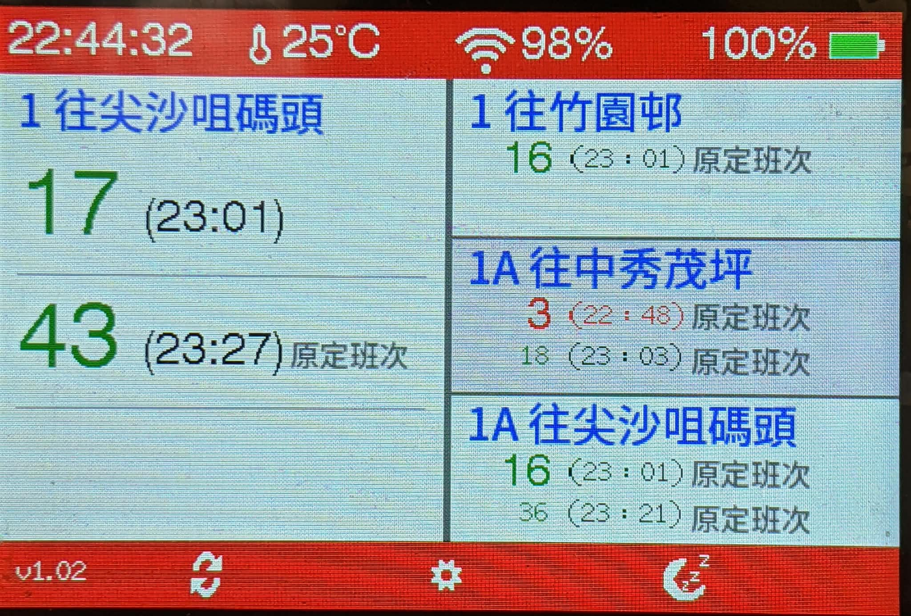

[English](#english) | [繁體中文](#繁體中文)

---

## English

# 🚌 KMB ETA System

[](https://www.espressif.com/)
[](https://github.com/lovyan03/LovyanGFX)
[](LICENSE)

A standalone, touch-enabled real-time Kowloon Motor Bus (KMB) arrival display powered by **ESP32-S3** and **LovyanGFX**.

**Created by: KC427**



---

## 📖 Overview

**KMB ETA System** is a compact desktop and portable bus arrival dashboard built on the **Waveshare ESP32-S3 Touch LCD 3.5** development board. It fetches live Estimated Time of Arrival (ETA) data directly from the KMB Open Data API alongside regional temperatures from the Hong Kong Observatory (HKO). Designed with a built-in Captive Portal and Web Configuration interface, all Wi-Fi credentials, screen layouts, and bus routes can be configured directly from your smartphone or PC browser without hardcoding anything in the firmware.

---

## ✨ Key Features

- **Real-Time KMB Arrival Countdowns**: Displays live arrival minutes, scheduled times, and service remarks with color-coded urgency alerts.
- **Flexible Multi-Route Layouts**: Switch between **3 split-screen layouts** to monitor 2, 3, or 4 bus routes simultaneously.
- **Zero-Code Wi-Fi Onboarding**: Automatically boots into Access Point (AP) mode (`KMB-ETA-Setup`) with a Captive Portal for effortless smartphone Wi-Fi setup.
- **Built-in Web Route Configurator**: Search and select bus routes, directions, stops, and HKO weather districts via a responsive web interface on your phone or PC.
- **Interactive Touch UI & Power Management**:
  - Configurable PWM backlight brightness (`5%` – `100%`) and data refresh intervals (`15s` – `2m`).
  - Hardware **Deep Sleep** mode (manual trigger or auto-idle timer) with instant touch wake-up and AXP2101 battery monitoring.
- **Crisp Chinese Typography**: Renders smooth `.vlw` Traditional Chinese fonts stored in `LittleFS` and cached in PSRAM.

---

## 📚 Documentation

For detailed hardware specifications, firmware flashing instructions, and daily operation guides, please refer to the documentation in the `docs/` directory:

| Document | Description |
| :--- | :--- |
| 🔌 **[Hardware Requirements & Pinout](docs/HARDWARE.md)** | Component list, hardware selection notes (3.5 vs. 3.5B), and built-in SPI / I2C GPIO pinouts. |
| ⚙️ **[Setup & Installation Guide](docs/SETUP.md)** | Arduino IDE setup, `LovyanGFX` library installation, `LittleFS` font upload, and flashing steps. |
| 📘 **[User Manual & Operations Guide](docs/USER_MANUAL.md)** | Step-by-step guide for first-time AP setup, touch UI controls, system settings, and Web Portal route configuration. |
| 🛠️ **[Troubleshooting Guide](docs/TROUBLESHOOTING.md)** | Common issues, Wi-Fi/LittleFS debugging tips, and solutions *(Work in Progress)*. |

---

## 📂 Repository Structure

```text
KMB-ETA-System/
├── KMB-ETA-System.ino       # Main ESP32-S3 firmware
├── icons.cpp                # Monochrome UI bitmap icons .cpp
├── icons.h                  # Monochrome UI bitmap icons .h
├── data/                    # LittleFS smooth font assets (.vlw)
├── docs/                    # Detailed documentation & UI screenshots
│   ├── HARDWARE.md
│   ├── SETUP.md
│   ├── USER_MANUAL.md
│   ├── TROUBLESHOOTING.md
│   └── images/
├── LICENSE                  # MIT License
└── README.md                # Project overview
```

---

## 🙏 Data Sources & Credits

- **Bus ETA Data**: [KMB / LWB Open Data API](https://data.etabus.gov.hk/) (`data.etabus.gov.hk`)
- **Weather Data**: [Hong Kong Observatory (HKO) Open Data API](https://data.weather.gov.hk/)
- **Display & Touch Graphics**: [LovyanGFX](https://github.com/lovyan03/LovyanGFX)
- **Author**: **KC427**

---

## 📄 License

This project is open-source and licensed under the **MIT License** — see the [LICENSE](LICENSE) file for details.

---

## 繁體中文

# 🚌 KMB ETA System

[](https://www.espressif.com/)
[](https://github.com/lovyan03/LovyanGFX)
[](LICENSE)

一款基於 **ESP32-S3** 與 **LovyanGFX** 開發的獨立式觸控九巴（KMB）實時到站時間顯示系統。

**作者：KC427**


---

## 📖 專案簡介

**KMB ETA System** 是一款建基於 **Waveshare ESP32-S3 Touch LCD 3.5** 開發板的輕巧桌面及便攜式巴士到站資訊顯示屏。系統直接從九巴開放數據 API（KMB Open Data API）抓取實時預計到站時間（ETA），並同步顯示香港天文台（HKO）的分區氣溫資訊。本專案內置強制門戶網頁（Captive Portal）及網頁設定介面（Web Configuration），所有 Wi-Fi 連線資料、畫面佈局及巴士路線均可直接透過手機或電腦瀏覽器設定，無需在韌體程式碼中預先寫死任何參數。

---

## ✨ 主要功能特色

- **九巴實時到站倒數**：即時顯示預計到站分鐘數、預定班次時間及車務備註，並設有顏色提示即將到站班次。
- **靈活多路線分屏佈局**：支援切換 **3 種分屏顯示模式**，可同時監察 2、3 或 4 條巴士路線。
- **免改碼智能 Wi-Fi 配網**：首次開機自動啟動熱點（AP）模式（`KMB-ETA-Setup`）並彈出 Captive Portal 網頁，透過手機即可輕鬆完成 Wi-Fi 設定。
- **內置網頁版路線設定器**：透過手機或電腦瀏覽器的響應式網頁介面，輕鬆搜尋及選擇巴士路線、行車方向、上車站點及天文台氣溫分區。
- **互動觸控介面與電源管理**：
  - 支援自訂 PWM 背光亮度（`5%` – `100%`）及數據更新頻率（`15秒` – `2分鐘`）。
  - 支援硬件 **Deep Sleep（深度睡眠）** 模式（可手動點擊或設定閒置自動休眠），具備輕觸屏幕即時喚醒及 AXP2101 電池電量監察功能。
- **清晰流暢中文字型顯示**：透過 `LittleFS` 儲存並預載入 PSRAM 緩衝區，渲染高清平滑的 `.vlw` 繁體中文字體。

---

## 📚 說明文件

有關詳細的硬件規格、韌體燒錄教學及日常操作指南，請參閱 `docs/` 資料夾內的相關文件：

| 文件名稱 | 內容簡介 |
| :--- | :--- |
| 🔌 **[硬件需求與引腳定義](docs/HARDWARE.md)** | 組件清單、硬件選型備註（3.5 與 3.5B 之比較），以及內置 SPI / I2C GPIO 引腳定義。 |
| ⚙️ **[環境設定與燒錄指南](docs/SETUP.md)** | Arduino IDE 設定、`LovyanGFX` 程式庫安裝、`LittleFS` 字型上傳及程式碼燒錄步驟。 |
| 📘 **[用戶操作手冊](docs/USER_MANUAL.md)** | 初次 AP 配網設定、觸控介面操作、系統設定選單及網頁版路線設定的逐步教學。 |
| 🛠️ **[常見問題與排錯指南](docs/TROUBLESHOOTING.md)** | 常見問題、Wi-Fi／LittleFS 除錯貼士及解決方案 *(持續更新中)*。 |

---

## 📂 專案目錄結構

```text
KMB-ETA-System/
├── KMB-ETA-System.ino       # ESP32-S3 主韌體程式碼
├── icons.cpp                # 單色介面點陣圖示實作檔 (.cpp)
├── icons.h                  # 單色介面點陣圖示標頭檔 (.h)
├── data/                    # LittleFS 平滑字型資源檔 (.vlw)
├── docs/                    # 詳細說明文件與介面截圖
│   ├── HARDWARE.md
│   ├── SETUP.md
│   ├── USER_MANUAL.md
│   ├── TROUBLESHOOTING.md
│   └── images/
├── LICENSE                  # MIT 授權條款
└── README.md                # 專案總覽主頁
```

---

## 🙏 數據來源與鳴謝

- **巴士到站時間數據**：[九巴／龍運開放數據 API](https://data.etabus.gov.hk/)（`data.etabus.gov.hk`）
- **天氣資訊數據**：[香港天文台（HKO）開放數據 API](https://data.weather.gov.hk/)
- **顯示屏與觸控圖形驅動**：[LovyanGFX](https://github.com/lovyan03/LovyanGFX)
- **作者**：**KC427**

---

## 📄 授權條款

本專案以開源形式發布，並採用 **MIT License** 授權條款 — 詳情請參閱 [LICENSE](LICENSE) 檔案。