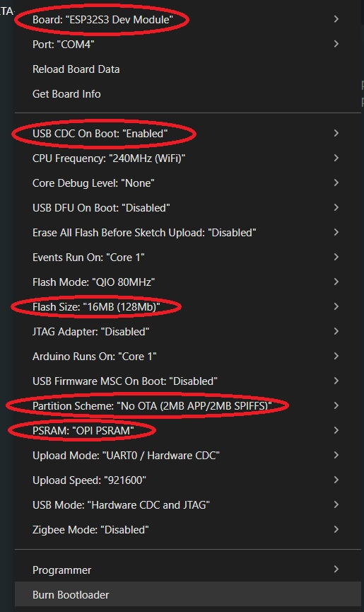

[English](#english) | [繁體中文](#繁體中文)
---

## English
# ⚙️ Setup & Installation Guide

Step-by-step instructions to set up your development environment, compile the code, and flash assets to your ESP32-S3 with 480x320 resolution.

---

## 1. Prerequisites
- **Arduino IDE** (v2.x recommended) with ESP32 board package installed.
- **Required Libraries**:
  - `LovyanGFX` (Install via Arduino Library Manager)

---

## 2. LittleFS Data Upload (Font Assets)
This project utilizes LittleFS to store `.vlw` smooth font files inside the `data/` folder.
1. Download the *ESP32 Sketch Data Upload* plugin for Arduino IDE.
2. Place your font assets inside the project's `data/` folder (note: this folder may be excluded from Git tracking).
3. To flash the file system to your board, [Click Here](https://randomnerdtutorials.com/arduino-ide-2-install-esp32-littlefs/) and follow the steps.

---

## 3. Compiling & Flashing Code
1. Open `KMB-ETA-System.ino` in Arduino IDE.
2. Configure the project setting as below: 

3. Compile and Upload the code to the board.

---

## 繁體中文

# ⚙️ 環境設定與燒錄指南

本指南提供逐步教學，協助你設定開發環境、編譯程式碼，並將字型資源燒錄至 ESP32-S3 開發板，解像度為 480x320。

---

## 1. 前置準備
- **Arduino IDE**（建議使用 v2.x 版本），並已安裝 ESP32 開發板支援套件。
- **必備程式庫**：
  - `LovyanGFX`（可透過 Arduino 程式庫管理員安裝）

---

## 2. 上傳 LittleFS 檔案系統（字型資源）
本專案採用 LittleFS 檔案系統，將 `.vlw` 平滑字型檔案儲存在 `data/` 資料夾內。
1. 下載並安裝適用於 Arduino IDE 的 *ESP32 Sketch Data Upload* 插件。
2. 將字型資源檔案放入專案目錄下的 `data/` 資料夾內（註：此資料夾可能未包含在 Git 版本追蹤中）。
3. 如需將檔案系統燒錄至開發板，請[點擊此處](https://randomnerdtutorials.com/arduino-ide-2-install-esp32-littlefs/)並依照步驟操作。

---

## 3. 編譯與燒錄程式碼
1. 在 Arduino IDE 中開啟 `KMB-ETA-System.ino`。
2. 依照下圖設定專案編譯參數：

3. 編譯（Compile）並將程式碼上傳（Upload）至開發板。
