[English](#english) | [繁體中文](#繁體中文)
---

## English

# 📘 User Manual & Operations Guide

How to operate, configure, and interact with your KMB ETA System on a daily basis.

---

## 🚀 1. First-Time Operation & Wi-Fi Setup
Because this system features an intelligent Wi-Fi configuration portal, you **do not** need to hardcode your network credentials into the source code!

1. **Power On**: Connect the device to a stable 5V power source using a USB Type-C cable.

2. **AP Mode Activation**: Upon first boot (or if the saved Wi-Fi cannot be reached), the ESP32-S3 will automatically enter **Access Point (AP) Mode**.

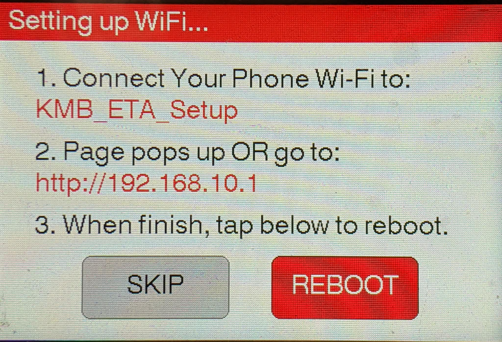

3. **Connect via Phone**: 
   - Open your smartphone's Wi-Fi settings and look for an open network named **`KMB-ETA-Setup`** .
   - Connect to it. A configuration portal page should automatically pop up on your phone screen (Captive Portal).
   
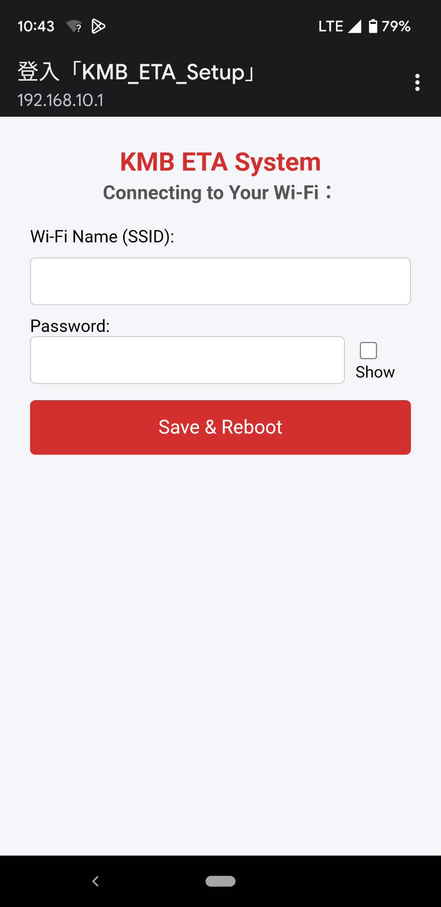

4. **Enter Credentials**: Select your home Wi-Fi SSID, enter your password, and hit **Save**.

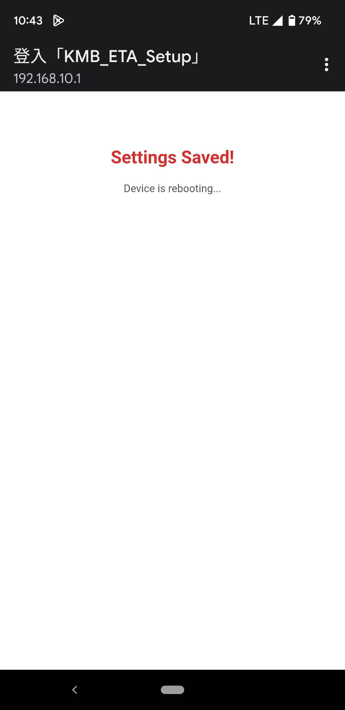

5. **Automatic Reboot**: The device will save your credentials to flash memory and automatically reboot to connect to your live network.

---

## 🧭 2. Basic Operation & Display Guide
The screen layout and on-screen controls are designed for intuitive daily usage:

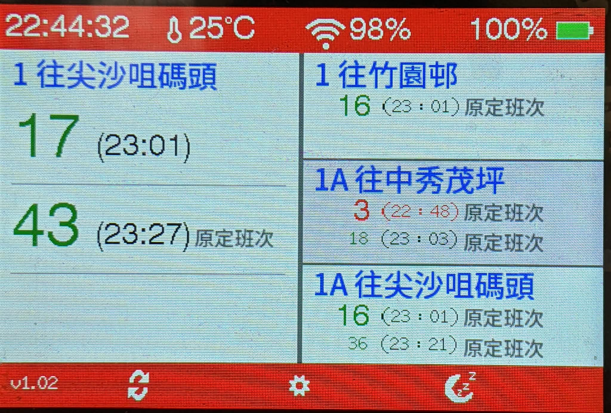

- **Connection & Status Bar**: Indicates Wi-Fi signal strength, battery status, and the last updated time.
- **Main ETA Display**: Shows live estimated time of arrival (in minutes) and route countdowns for your configured buses.
- **Footer - Setting Button (Center)**: 
  - Tap the icon at the **bottom center** of the screen to enter the Setup Menu.
- **Footer - Sleep Mode (Right)**: 
  - Tap the icon at the **bottom right** of the screen to toggle **Sleep Mode** (turns off the backlight, puts the display into low-power standby, and sets the ESP32 into deep sleep mode).

---

## ⚙️ 3. Configuration & Setup Menu

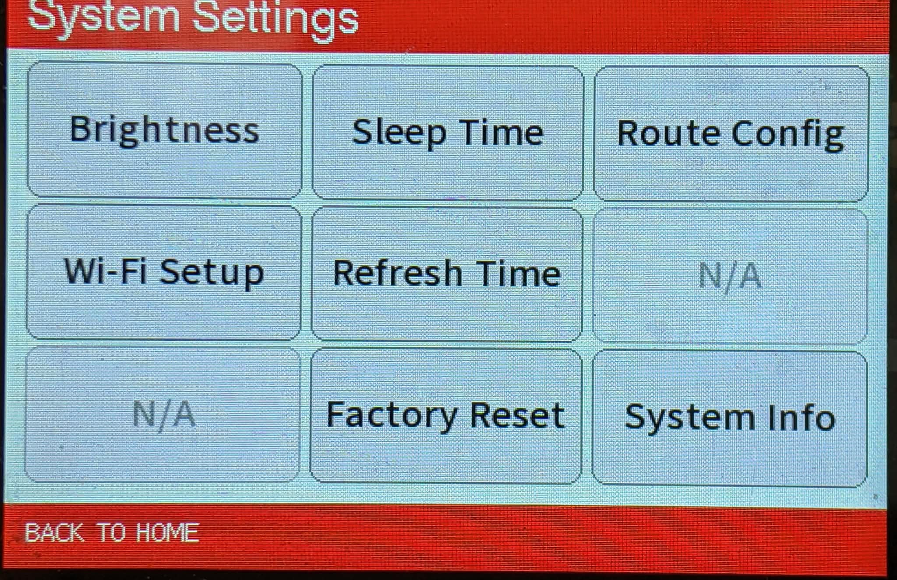

By tapping the **Setting** button at the bottom center of the screen, you can access the Setup Menu to configure the following options:

- **Display Brightness**: Adjust the LCD backlight intensity to suit your desk or room lighting environment.

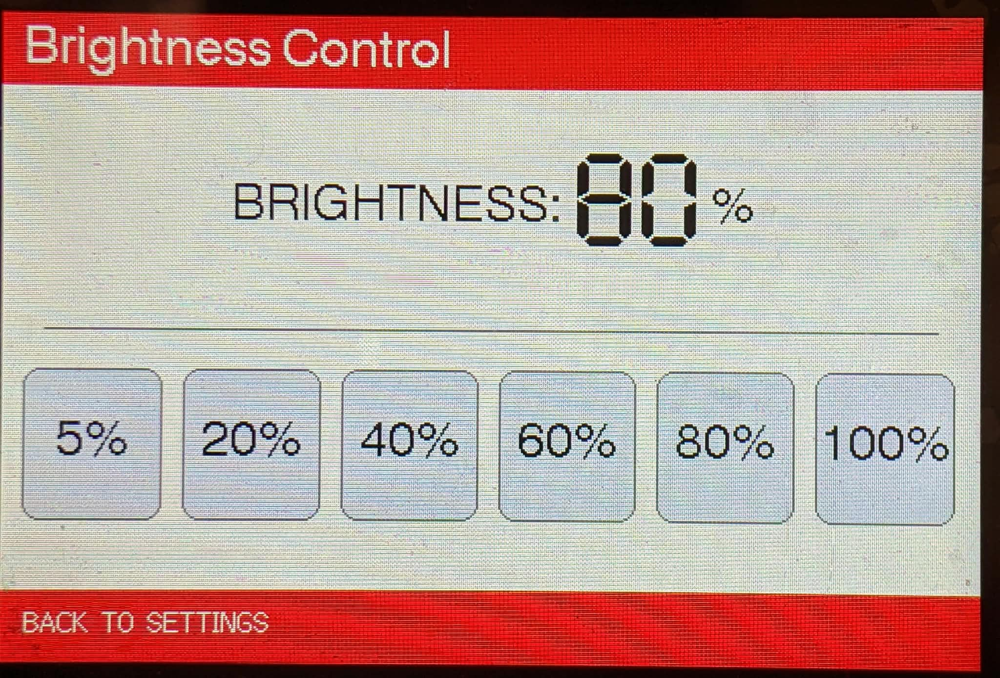

- **Sleep Time**: Set the idle duration before the system automatically enters sleep mode.

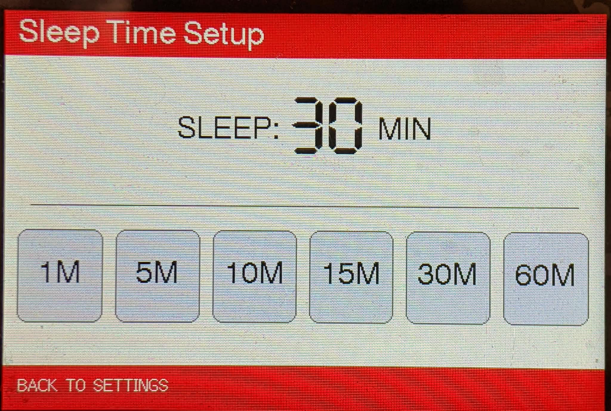

- **Route Config**: Configure your preferred bus routes and stop selections.

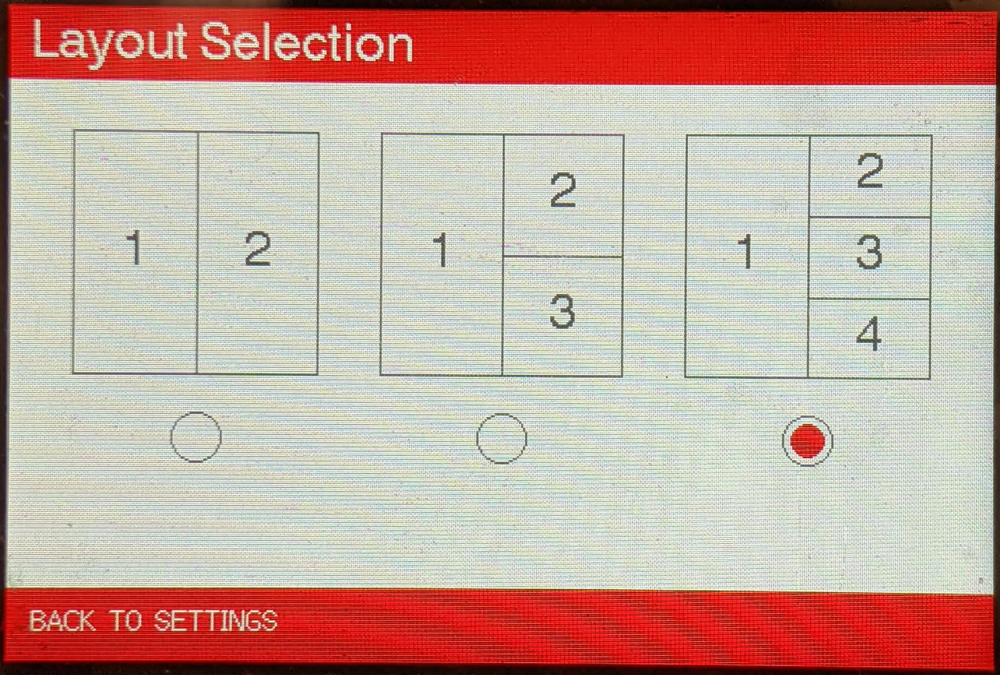

- **Wi-Fi Setup**: Reconfigure your network credentials if you change your router or Wi-Fi password.

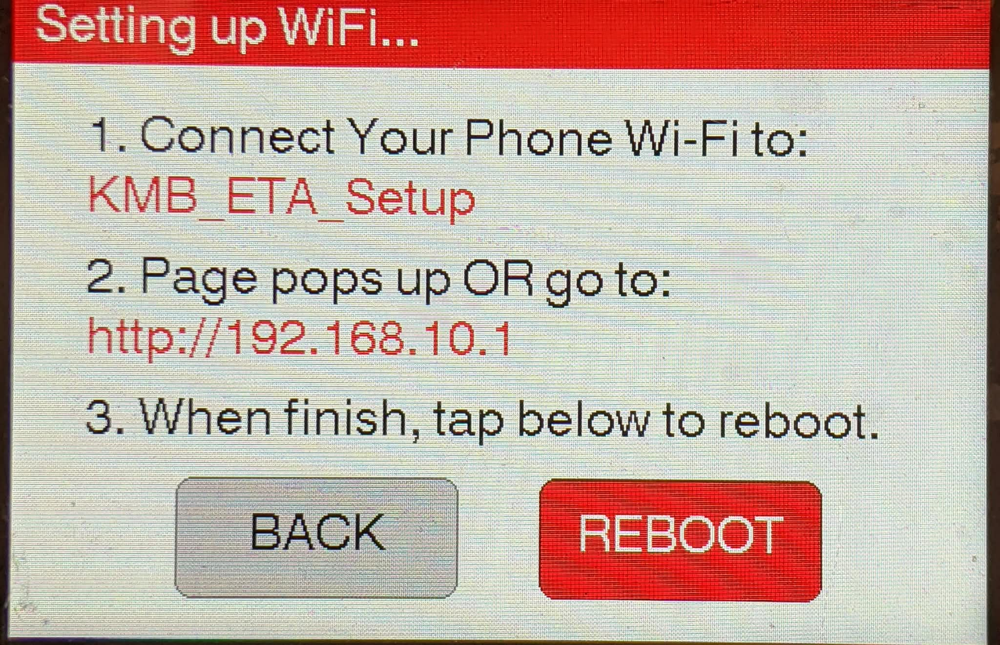

- **Refresh Time**: Adjust the update intervals for fetching live bus countdowns.

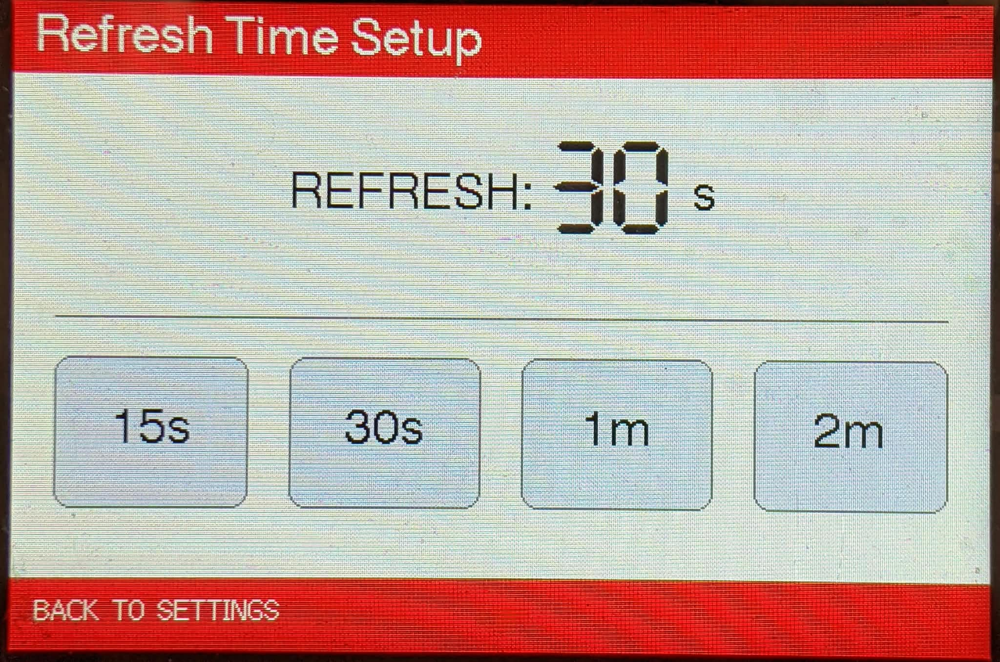

- **Factory Reset**: Erase all saved configurations and restore the system to default settings.

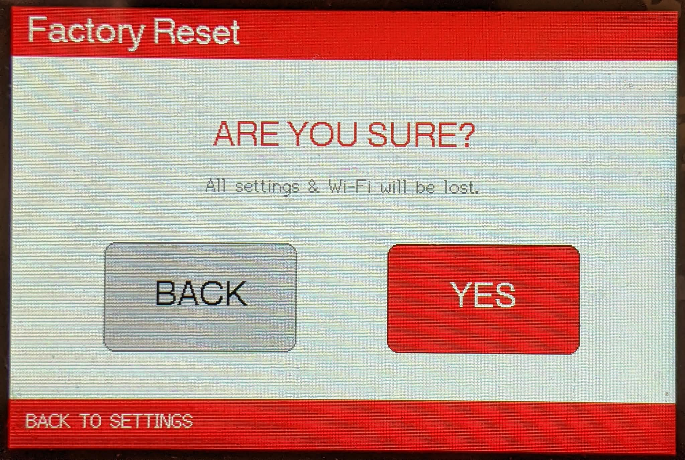

- **System Info**: View device firmware version, network status, and hardware information.

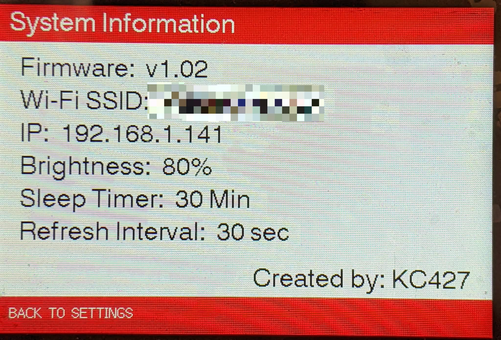

---

## 📶 4. Wi-Fi Setup & Re-configuration
If you change your home router, SSID, or Wi-Fi password, you can easily reconfigure the network settings:

1. **Trigger Setup Mode**: Access the Setup Menu via the screen's **Setting** button and select **Wi-Fi Setup** (or perform a reset if the device fails to connect to the previous network).

2. **Connect to AP**: Open your smartphone’s Wi-Fi settings and connect to the open access point named **`KMB-ETA-Setup`**.

3. **Captive Portal**: A configuration page should automatically pop up on your phone screen. If it doesn't, open a web browser and navigate to any non-HTTPS website (or type `192.168.10.1`).

4. **Save & Reboot**: Enter your new Wi-Fi SSID and password, then hit save. The device will automatically reboot and connect to your new network.

---

## 🚌 5. Route Configuration & Layout
The **Route Config** process is handled through a built-in web portal. This allows you to easily search and configure KMB bus routes using your smartphone or PC browser without the need to type on the small screen.

### Step-by-Step Setup:
1. **Enter Route Config**: Tap the **Setting** button at the footer of the main screen, then select **Route Config**.

2. **Select Screen Layout**: You will enter the "Layout Selection" screen. Choose your preferred display style by tapping on the layout icons:
   - **Layout 1**: 2 large route slots (Left and Right).
   - **Layout 2**: 3 route slots (1 large on the left, 2 smaller on the right).
   - **Layout 3**: 4 route slots (1 large on the left, 3 smaller on the right).
   *(Note: A red dot indicates your current selection. Tap your desired layout to confirm, eg, Layout 1)*

3. **Launch Web Portal**: After selecting a layout, the device will display a **Route Config Portal** screen showing your current Wi-Fi network and a local IP address (e.g., `http://192.168.X.X`).

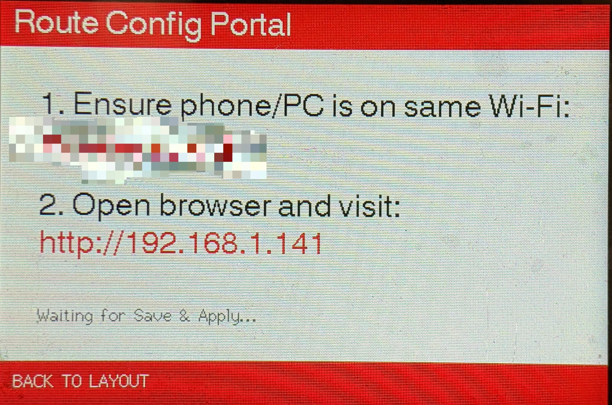

4. **Connect via Phone/PC**: Ensure your smartphone or computer is connected to the **same Wi-Fi network**. Open a web browser and enter the exact IP address shown on the ESP32 screen.

> ⚠️ **Important Note**: Using a "Guest Wi-Fi" network from your home router may prevent you from accessing the portal due to standard security blocking (AP Isolation). Please ensure both devices are on your primary home network.

5. **Configure Settings in Browser**: The KMB ETA Configuration page will load in your web browser.

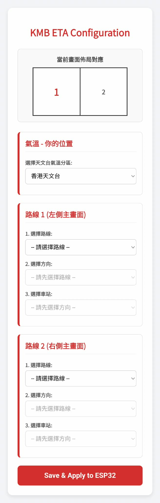

   - **Weather Location**: Select your preferred regional weather station for the top bar temperature display.
   - **Route Selection**: For each display slot, configure the route using the 3 dropdown menus:
     - **1. Route**: Select the bus number (e.g., 1A, 98D).
     - **2. Direction**: Choose the destination and service type (Regular/Special).
     - **3. Stop**: Select your exact boarding stop. *(Note: The stop list is fetched live from KMB servers; please wait a few seconds for the dropdown to populate after selecting a direction).*

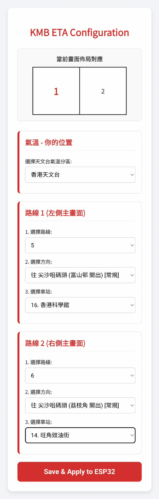

6. **Save & Reboot**: Once all slots are configured, scroll to the bottom and click **"Save & Apply to ESP32"**. The device will save your preferences and automatically reboot to display your new routes.

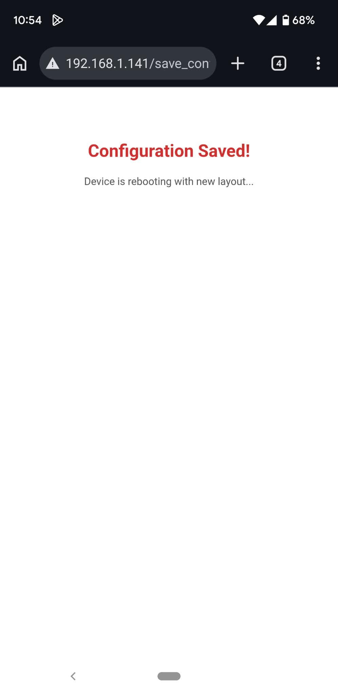

---

## 繁體中文

# 📘 用戶操作手冊

本手冊詳細說明 KMB ETA System 的日常操作、介面功能及各項設定方式。

---

## 🚀 1. 初次開機與 Wi-Fi 配網設定
由於本系統內置智能 Wi-Fi 配網網頁（Captive Portal），你**無需**在程式碼中預先寫死 Wi-Fi 名稱及密碼：

1. **接通電源**：使用 USB Type-C 電源線將裝置連接至穩定的 5V 電源。

2. **啟動 AP 模式**：首次開機（或無法連接已儲存的 Wi-Fi 網絡）時，ESP32-S3 會自動進入**熱點（AP）配網模式**。

3. **透過手機連線**：
   - 開啟手機的 Wi-Fi 設定，搜尋並連接名為 **`KMB-ETA-Setup`** 的開放式網絡。
   - 連線後，手機螢幕會自動彈出 Wi-Fi 設定網頁（Captive Portal）。

   

4. **輸入網絡資料**：選擇或輸入你的家居 Wi-Fi 名稱（SSID）及密碼，然後點擊 **Save**。

5. **自動重新啟動**：裝置會將網絡資料儲存至快閃記憶體，並自動重新啟動以連接你的 Wi-Fi 網絡。

---

## 🧭 2. 基本操作與畫面說明
螢幕版面與觸控按鍵專為直觀的日常操作而設：

- **連線與狀態欄**：顯示 Wi-Fi 訊號強度、電池狀態及最後更新時間。
- **主畫面巴士到站時間**：即時顯示已設定巴士路線的預計到站分鐘數及班次倒數。
- **底部工具列 - 設定按鈕（正中）**：
  - 點擊螢幕**底部正中**的圖示，即可進入系統設定選單（Setup Menu）。
- **底部工具列 - 睡眠模式（右側）**：
  - 點擊螢幕**底部右側**的圖示，可切換至**睡眠模式**（關閉背光、令顯示屏進入低功耗待機狀態，並將 ESP32 切換至 Deep Sleep 深度睡眠模式）。

---

## ⚙️ 3. 系統設定與選單功能

點擊螢幕底部正中的 **Setting** 按鈕進入設定選單後，可調校以下各項功能：

- **Display Brightness（顯示屏亮度）**：調校 LCD 背光亮度，以配合書桌或室內的光線環境。

- **Sleep Time（自動睡眠時間）**：設定系統在閒置多久後自動進入睡眠模式。

- **Route Config（路線設定）**：自訂你常用的巴士路線及上車站點。
 

- **Wi-Fi Setup（Wi-Fi 設定）**：當更換路由器或更改 Wi-Fi 密碼時，可重新設定網絡資料。
 

- **Refresh Time（更新頻率）**：調校抓取即時巴士到站倒數的時間間隔。
 

- **Factory Reset（恢復原廠設定）**：清除所有已儲存的設定，並將系統還原至預設狀態。
 

- **System Info（系統資訊）**：檢視裝置韌體版本、網絡連線狀態及硬件資訊。
 

---

## 📶 4. Wi-Fi 重新設定與更改網絡
如果你更換了家居路由器、SSID 或 Wi-Fi 密碼，可輕鬆重新設定網絡連線：

1. **啟動設定模式**：點擊主畫面的 **Setting** 按鈕進入設定選單，然後選擇 **Wi-Fi Setup**（若裝置無法連接先前的網絡，亦可透過重置進入配網模式）。

2. **連接至 AP 熱點**：開啟手機的 Wi-Fi 設定，並連接至名為 **`KMB-ETA-Setup`** 的開放式熱點。

3. **開啟強制門戶網頁（Captive Portal）**：手機螢幕會自動彈出設定網頁。如未有自動彈出，請開啟瀏覽器並前往任何非 HTTPS 網站（或直接輸入 `192.168.10.1`）。

4. **儲存並重新啟動**：輸入新的 Wi-Fi SSID 及密碼，然後點擊儲存。裝置會自動重新啟動並連接至新網絡。

---

## 🚌 5. 路線設定與版面佈局
**Route Config** 透過內置網頁介面（Web Portal）運作，讓你直接利用手機或電腦瀏覽器輕鬆搜尋及設定九巴路線，無需在小型螢幕上打字。

### 設定步驟：
1. **進入路線設定**：點擊主畫面底部的 **Setting** 按鈕，然後選擇 **Route Config**。

2. **選擇畫面佈局（Layout Selection）**：進入「Layout Selection」畫面後，點擊對應的佈局圖示以選擇顯示格數：
   - **Layout 1**：2 個大尺寸路線顯示格（左、右各一）。
   - **Layout 2**：3 個路線顯示格（左側 1 個大格，右側 2 個細格）。
   - **Layout 3**：4 個路線顯示格（左側 1 個大格，右側 3 個細格）。
   *(註：紅點代表目前所選的佈局，點擊目標佈局即可確認，例如 Layout 1。)*

3. **啟動網頁設定介面**：選定佈局後，裝置會顯示 **Route Config Portal** 畫面，並列出當前連接的 Wi-Fi 網絡及區域網絡 IP 位址（例如 `http://192.168.X.X`）。

4. **透過手機或電腦連線**：確保你的手機或電腦與 ESP32 連接至**同一個 Wi-Fi 網絡**，開啟瀏覽器並輸入螢幕上顯示的完整 IP 位址。

> ⚠️ **重要提示**：使用家居路由器的「訪客網絡（Guest Wi-Fi）」可能會因預設的安全隔離機制（AP Isolation）而無法存取設定網頁。請確保手機／電腦與裝置均連接至主要家居網絡。

5. **在瀏覽器中自訂設定**：網頁會載入 **KMB ETA Configuration** 設定頁面。

   - **Weather Location（氣溫地區）**：選擇頂部狀態欄顯示的天文台分區氣溫站點。
   - **Route Selection（路線選擇）**：為每個顯示格位透過三個下拉式選單設定路線：
     - **1. Route（路線）**：選擇巴士路線號碼（例如 `1A`、`98D`）。
     - **2. Direction（方向）**：選擇行車方向及班次類型（常規／特別班）。
     - **3. Stop（車站）**：選擇你的上車車站。*(註：選定方向後，網頁會即時向九巴伺服器抓取車站清單，請稍候數秒待下拉式選單載入完成。)*

6. **儲存並重新啟動**：全部顯示格設定完成後，捲動至頁面底部並點擊 **「Save & Apply to ESP32」**。裝置會儲存你的設定並自動重新啟動，隨即顯示新設定的巴士路線。

